# Sample Output

Screenshots below are taken from the toolkit's PDF report export, run on the built-in sample dataset (cycles-based data, 13 failures / 3 suspensions). They're included to show what each analysis path actually produces, not just describe it.

See [FEATURES.md](FEATURES.md) for the full feature list, the [README](README.md) for an overview and download link, and [CHANGELOG.md](CHANGELOG.md) for what's new in v3.0.

## Life Data Analysis

**2-Parameter Weibull** — rank regression fit with a 90% beta-binomial confidence band on the regression chart, confidence bounds (Fisher Matrix, Likelihood Ratio, Bayesian, and bootstrap), and a Distribution Fit Comparison against Exponential and Lognormal on the same data.

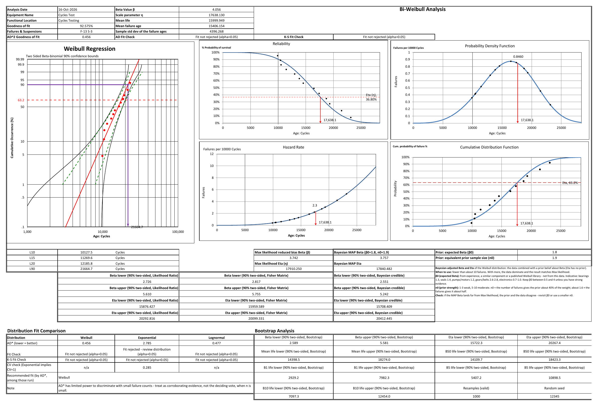

**Bootstrap confidence intervals (new in v3.0)** — the bootstrap details sheet: parametric bootstrap intervals for Beta, Eta, mean life and B-lives, set beside the Fisher Matrix limits, with the number of resamples and the random seed recorded so the run can be repeated.

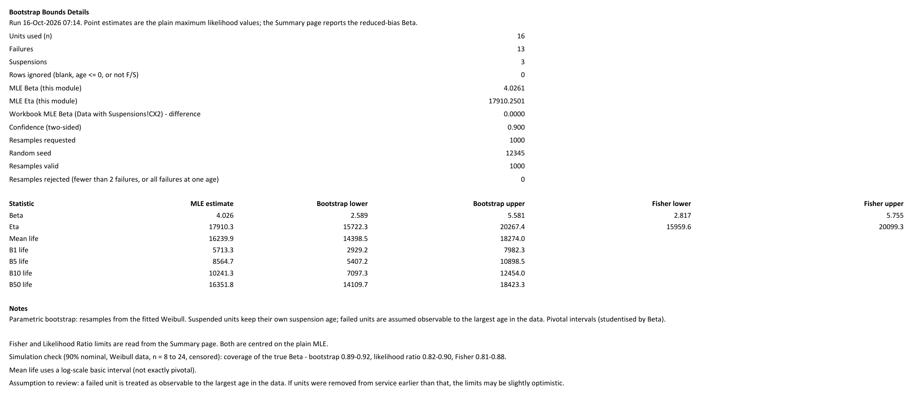

**3-Parameter ("Tri") Weibull** — same layout, with a fitted minimum-life (location) parameter and Gamma-shifted Bayesian Eta bounds.

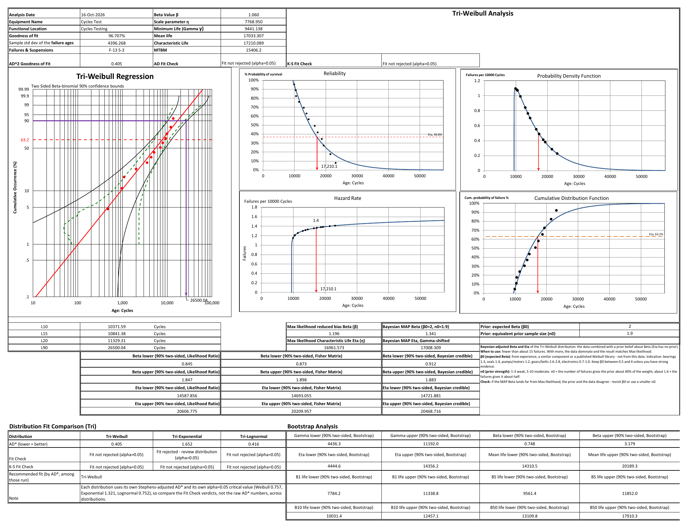

**Kaplan-Meier survival curve** — the non-parametric overlay, shown independently of any distributional assumption, for sanity-checking the parametric fit above. A "Reading the chart" table (new in v3.0) gives survival at evenly spaced ages.

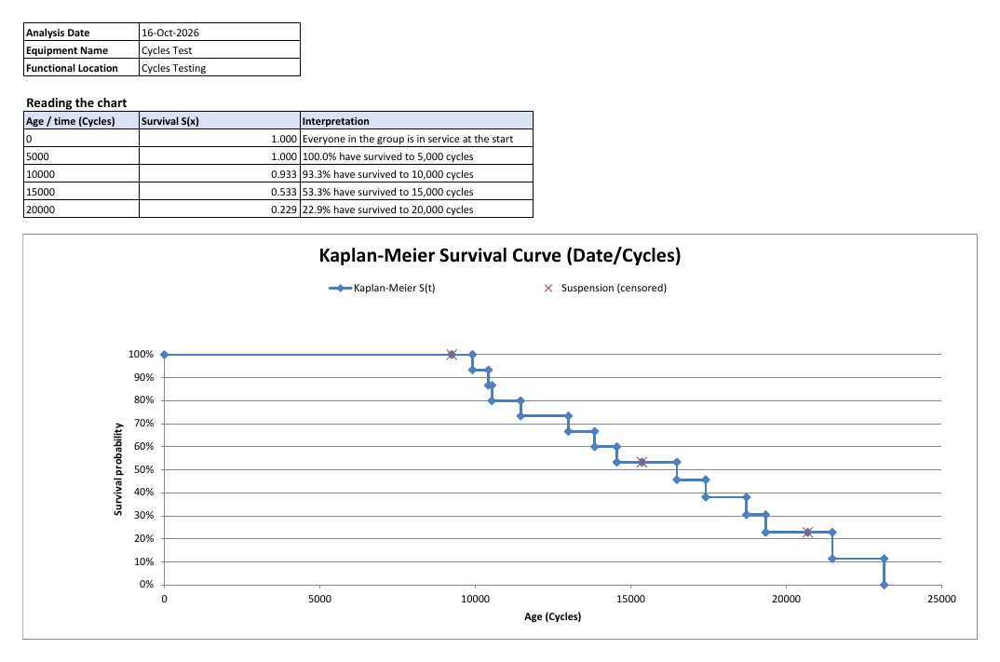

## Forecasting & Cost Optimization

**5-year failure forecast** — cumulative predicted failures for the remaining in-service (suspended) population, plus an on-sheet "what-if" calculator for an arbitrary future interval.

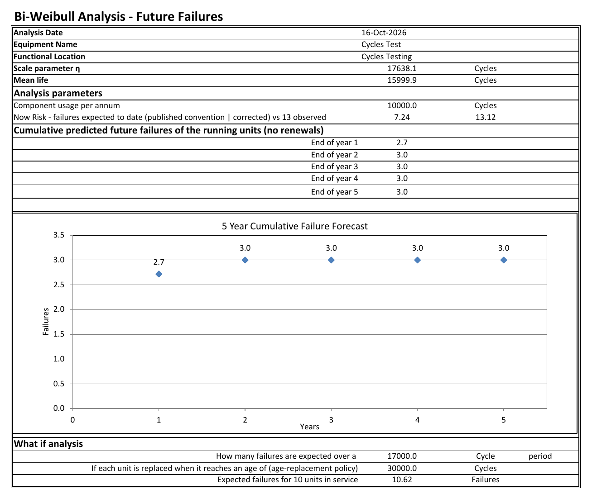

**Cost vs. replacement age** — run-to-failure vs. planned-replacement cost tradeoff, with the optimal preventive replacement interval marked directly on the curve. Replacement downtimes (Tp, Tf) are optional inputs in v3.0.

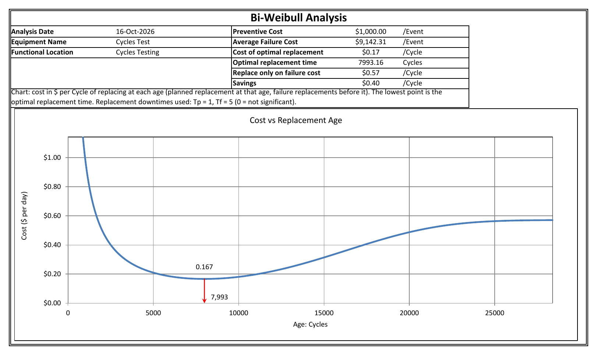

**Spares forecast** — expected preventive and failure replacements per year from the renewal method, with the spares-to-stock figure at a confidence level you choose (new in v3.0), and the saving against a replace-on-failure policy.

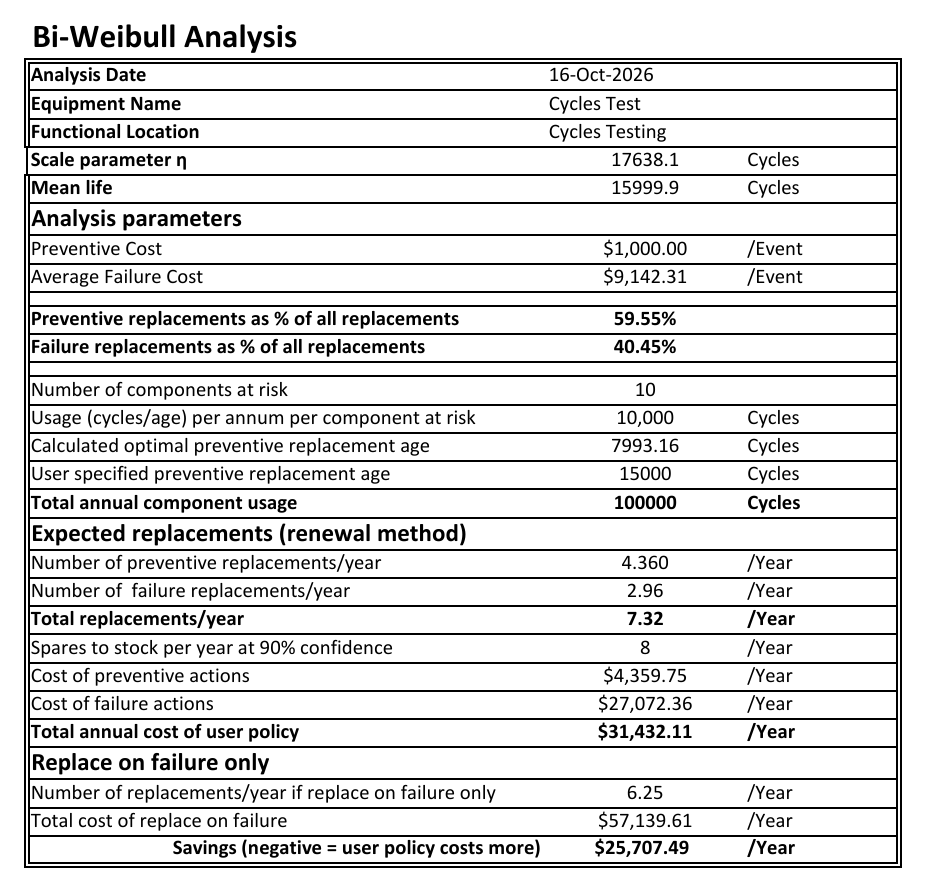

## Reliability Growth (Crow-AMSAA)

**Cycles-based Crow-AMSAA analysis** — NHPP power-law fit on cumulative age vs. cumulative failures, Crow/MIL-HDBK-189 confidence bounds, and the Laplace trend test verdict (here: no significant trend, consistent with a homogeneous Poisson process). New in v3.0 on the same page: the Duane reliability growth plot and MTBF check, cumulative and instantaneous MTBF, and parametric bootstrap bounds.

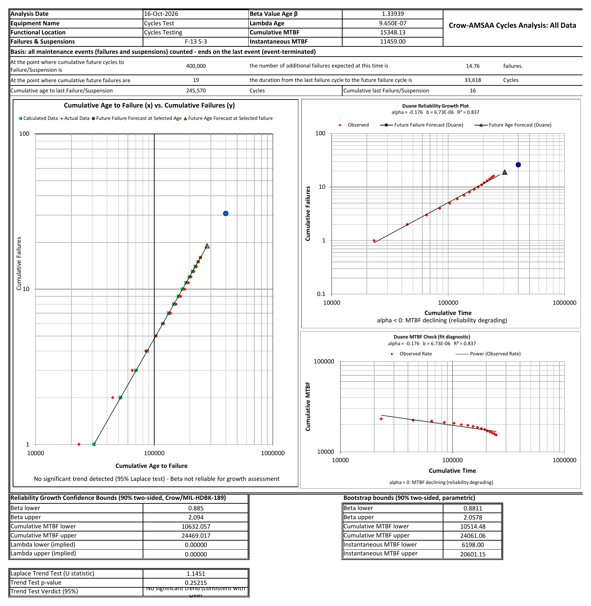

**Multi-phase Crow-AMSAA (new in v3.0)** — a separate Beta and Lambda fitted to each phase, with the phase boundary chosen by you or suggested by the change-point detector, and the phases plotted on one chart.

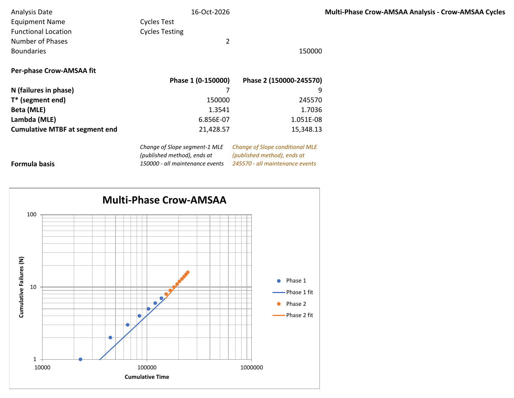

**Cost optimiser** — from the fitted Beta/Lambda, the overhaul interval that minimises the cost rate, marked on the cost-rate curve.

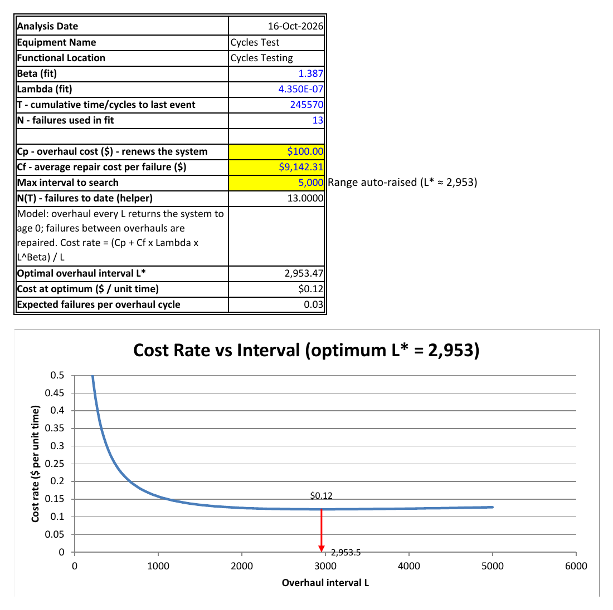

**Spares optimiser** — critical-fractile (newsvendor) stock-level optimisation: expected demand distribution over the review interval, and total expected cost vs. stock level with the minimum marked.

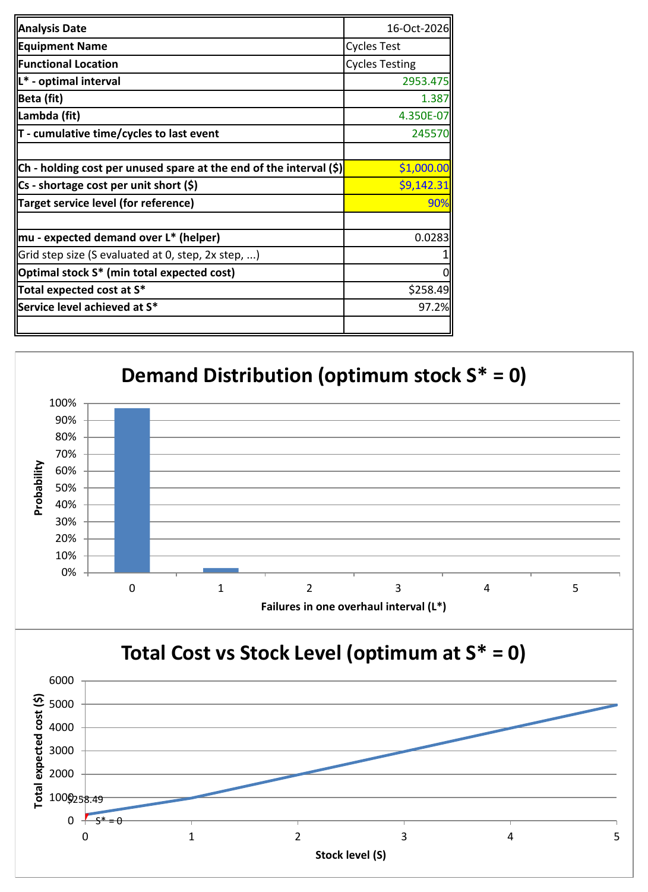

## Plant-Level Maintenance Cost Forecast

**Multi-year CMMS-driven forecast** — corrective cost (Crow-AMSAA-driven) and preventive cost (flat average) modeled as separate streams, rolled up into a 5-year total maintenance cost projection with an approximate 90% interval, shown with the key results, the key Pareto results, and the real cost per failure by year. In v3.0 this report is the **Maintenance Cost Forecast** sheet.

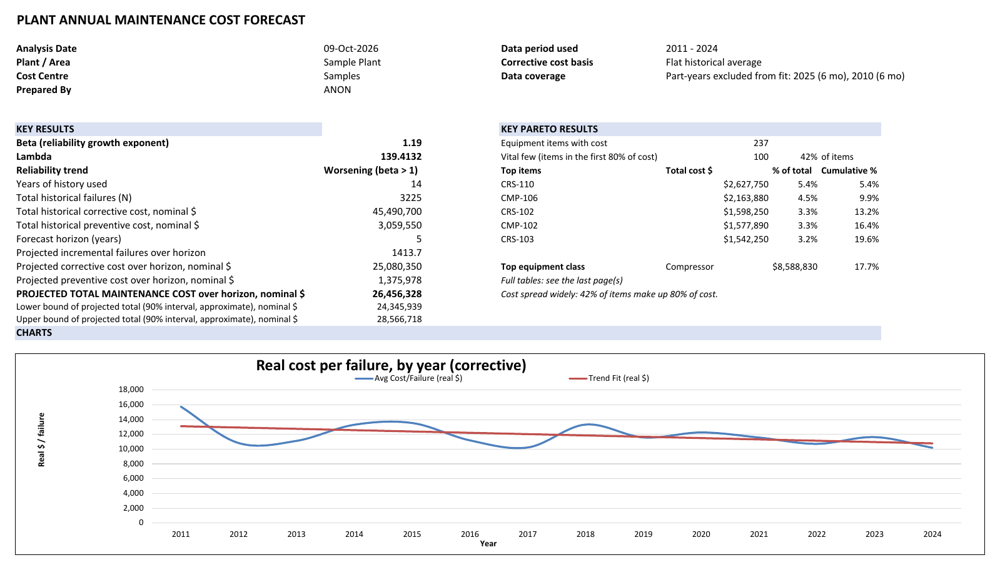

**History and forecast** — total annual maintenance cost by year, with the lower and upper 90% forecast bounds, followed by the equipment Pareto chart in the full report.

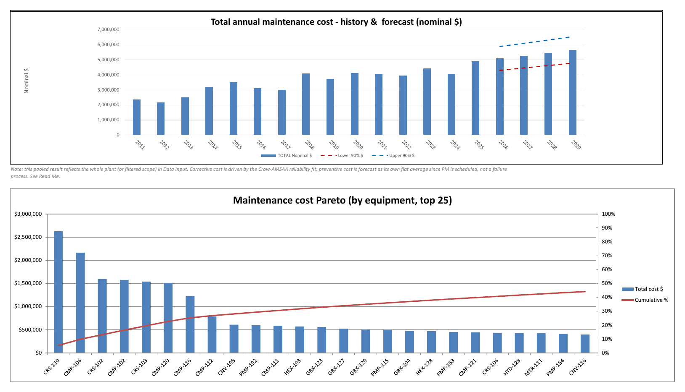

---

*All figures above use the workbook's built-in sample dataset — no real equipment, plant, or cost data is shown.*
